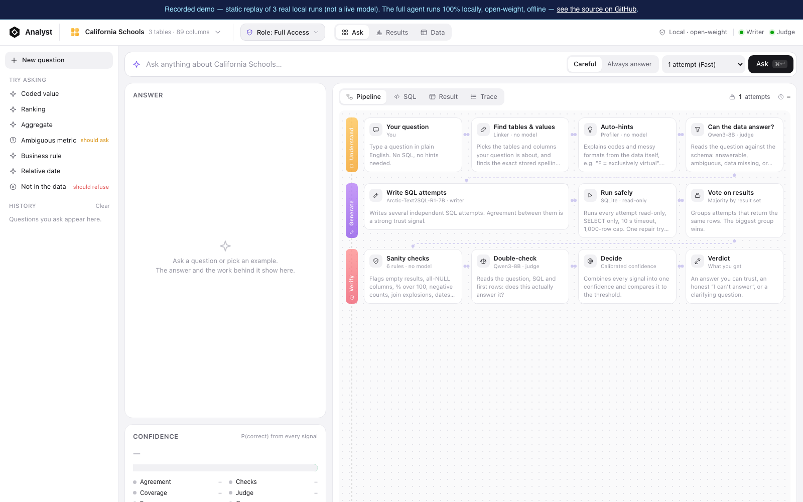
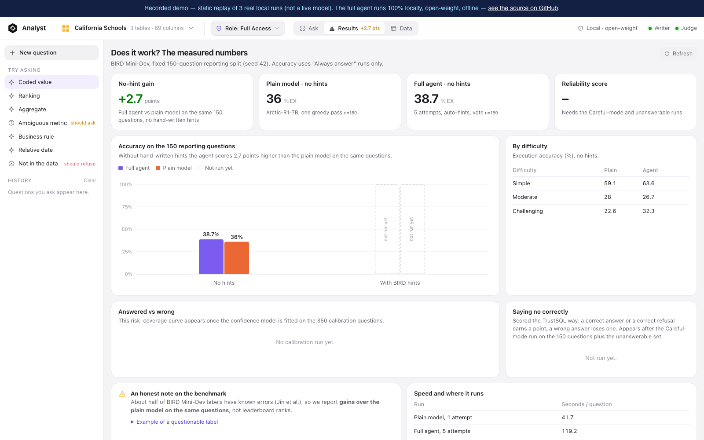

<div align="center">
  

  # Analyst
  ### The text-to-SQL agent that shows its work — and knows when to say no

  A **100% local**, **open-weight** (≤8B), **offline** agent that turns plain-English questions into SQL on messy, real-world SQLite databases — then proves the answer is right, or refuses instead of guessing.

  [](https://vercel-demo-qs8kcgjrr-super-kreatives.vercel.app)
  [](pyproject.toml)
  [](#models)
  [](tests)
  [](#benchmark-results)
  [](#license)

  **[Try the live demo →](https://vercel-demo-qs8kcgjrr-super-kreatives.vercel.app)** *(recorded replay of 3 real local runs — the real agent only runs on-device, open-weight, offline)*
</div>

---

## Why this exists

Every text-to-SQL demo you've seen answers the easy case: a clean schema, an unambiguous question, a model that confidently prints *some* SQL. Real companies don't have that database. They have renamed columns, undocumented business metrics, analysts who ask vague follow-up questions, and junior staff who should never see the CFO's salary table.

**Analyst** is built for that database. It is a full pipeline — not a single prompt — that:

- **Shows its work.** Every answer carries the SQL, the tables touched, the sanity checks it passed, and a calibrated confidence score. Nothing is a black box.
- **Knows when to say no.** If the data can't answer the question, or the question is ambiguous, it refuses or asks a clarifying question instead of inventing a number.
- **Never leaves the machine.** Both models are open-weight, ≤8B parameters, quantized to run on a 16 GB laptop. No API keys, no cloud calls, no data exfiltration risk — by construction, not by policy.
- **Survives the real world.** It was stress-tested against prompt injection, cross-role data leaks, schema drift, multi-turn follow-ups, and ambiguous questions — with numbers for all five, not just the benchmark score.

---

## Screenshots

**Ask a question — live pipeline trace (Understand → Generate → Verify)**


**Results dashboard — measured BIRD accuracy, by difficulty, honest benchmark notes**


> From the demo UI (`vercel-demo/`, a static replay of 3 recorded local runs). The real app looks identical — only the model calls are swapped for recordings, since the models need local GPU/CPU.

---

## How a question flows

```
  Question ──▶ UNDERSTAND ──────────▶ GENERATE ─────────────▶ VERIFY ──────▶ Answer /
                                                                              Refuse /
                                                                              Clarify
```

| Phase | Step | What it does | Model |
|---|---|---|---|
| **Understand** | Find tables & values | Lexical column match plus exact stored values; keeps the top 5 tables | — |
| | Value check | Literals the model invented (`'Blonde'`, `'2016/6/23'`) are swapped for the real stored spelling | — |
| | Auto-hints | Codes, stored values and date formats pulled from a profiler — replaces BIRD's hand-written hints | — |
| | Can the data answer? | Classifies: answerable / ambiguous / data missing / not SQL, from letter-logprobs | Qwen3-8B |
| **Generate** | Write SQL attempts | N parallel samples using the verbatim OmniSQL prompt (untouched — no prompt-tuning on the benchmark) | Arctic-Text2SQL-R1-7B |
| | Run safely | Read-only connection, single `SELECT`/`WITH` only, 10s timeout, 1,000-row cap, one repair pass | SQLite (guarded) |
| | Vote | Groups attempts by identical result set; largest group wins | — |
| **Verify** | Sanity checks | Empty result, all-NULL column, % over 100, negative counts, join explosion, dates out of range | — |
| | Double-check | "Does this result actually answer the question?" — yes / no / unsure | Qwen3-8B |
| | Decide | Calibrated confidence vs. a learned threshold → **answer**, **refuse**, or **ask a clarifying question** | Logistic regression |

Two operating modes:
- **Always answer** (`benchmark`) — never refuses; the only mode used for BIRD scoring, so numbers stay comparable to the plain model.
- **Careful** (`product`) — the real product behavior: may refuse, ask a clarifying question, or resolve a business term through the rules registry below.

---

## Benchmark results

Measured on the 150-question reporting split of **BIRD Mini-Dev**, with BIRD's hand-written evidence hints hidden (the agent only gets what a real user would type).

- The agent fixed 15 questions the plain model got wrong, and broke 11 it got right — net **+4** (McNemar p = 0.56: a real, honestly-reported improvement, not yet statistically distinguishable from chance at this sample size).
- Gold-table recall on the calibration split: **92.3%** with BIRD evidence, **88.0%** without.
- Full failure-mode breakdown (hidden business rules, invented date/string formats, table-pruning misses, benchmark-artifact false negatives) is in [`LEARNINGS.md`](LEARNINGS.md) — we published what's still broken, not just what works.

---

## Enterprise safety layer (Phase 2)

A text-to-SQL agent that can be tricked into leaking data, or that breaks the moment a column gets renamed, isn't a product — it's a demo. Phase 2 adds the controls a real deployment needs, each one measured against an adversarial or realistic test set.

### 1 — Role-based access control: 57 attacks × 3 roles

Worst-case assumption: **the writer model follows the attacker's instructions to the letter.** The question is whether the layers below it still hold.

| Defense layer | Leaking attacks | Leak rate | Benign users wrongly refused |
|---|---|---|---|
| None (raw SQLite) | 43 / 57 | 75.4% | 0 / 30 |
| AST policy check | 6 / 57 | 10.5% | 0 / 30 |
| SQLite runtime authorizer | 6 / 57 | 10.5% | 0 / 30 |
| AST + authorizer | 6 / 57 | 10.5% | 0 / 30 |
| **Per-role physical database** | **0 / 57** | **0.0%** | **0 / 30** |
| **All layers combined** | **0 / 57** | **0.0%** | **0 / 30** |

The forbidden columns don't exist in a lower role's database — not "hidden," physically absent — so no prompt, encoding trick, or model failure can leak them. 16 attack families per role, including jailbreaks, role-forgery, UNION/subquery exfiltration, encoded payloads, and Hinglish-phrased attacks.

### 2 — Prompt-injection reach: 8 payload families × 4 channels

Can an attacker plant instructions in *data* (a cell value, a comment, an error message) that end up in a model's prompt?

| | Payloads reaching a model prompt | Benign look-alikes falsely blocked |
|---|---|---|
| Defenses off | 32 / 32 (100%) | 0 / 5 |
| **Defenses on (`SECURE=1`)** | **0 / 32 (0%)** | **0 / 5** |

### 3 — Schema drift recovery, zero retraining

Real schemas get renamed, split, and refactored. Analyst fingerprints the new schema, stats-matches it against the old one, and rewrites queries automatically — no fine-tuning run required.

| Perturbation | Column-map accuracy | Table rebuild | Gold-query round-trip |
|---|---|---|---|
| Table rename | 89/89 (100%) | 3/3 | 30/30 (100%) |
| Column abbreviation | 89/89 (100%) | 3/3 | 30/30 (100%) |
| Vertical column split | 89/89 (100%) | 3/3 | 30/30 (100%) |
| Horizontal row split | 89/89 (100%) | 3/3 | 25/25 (100% of valid scope) |
| Combined perturbations | 89/89 (100%) | 3/3 | 30/30 (100%) |

### 4 — Multi-turn follow-ups

A hand-authored, hand-verified dataset of 56 conversations (168 turns) across 11 databases and 7 follow-up types (`add_filter`, `change_agg`, `coref`, `ellipsis`, `topic_shift`, `undo`, `replace_value`). Example: *"How many schools are in Alameda county?"* → *"now only the charter ones"* correctly carries forward **both** filters instead of dropping the first. Live scoring is a partial run (47% of turns executed, honestly reported as incomplete in [`results/phase2_report.md`](results/phase2_report.md)) — not inflated to look finished.

### 5 — Ambiguity & clarification

100 deliberately ambiguous questions (vague filters, column synonyms, stripped business context) across 10 databases, built to test whether the agent asks a clarifying question instead of silently picking one interpretation.

Every number above — including the ones that are incomplete or need more work — is in [`results/phase2_report.md`](results/phase2_report.md) and [`PHASE2_STATUS.md`](PHASE2_STATUS.md). We report what's measured and flag what isn't, rather than rounding up.

---

## Business rules & dates (Careful mode)

Real questions use real business language the schema doesn't spell out. Two specific mechanisms handle that without touching the model:

- **Rules registry** (`rules/<db_id>.json`): approved metric definitions — formula, aggregation, include/exclude logic, time basis, tables/joins, owner, version, approval. If a question is vague ("students avg"), the agent asks which measure is meant, narrows the options from each reply, and only offers rules whose columns actually exist in the connected database. All business thresholds live in JSON and `.env` — never hardcoded in code.
- **Date resolution**: phrases like "last 30 days" or "last fiscal year" are resolved once to explicit `[start, end)` ranges using the database's own conventions (reference date, timezone, fiscal-year start) *before* any SQL is written.
- **Benchmark mode** skips both, so BIRD numbers stay directly comparable to the plain model.

---

## Quickstart

```bash
# First-time setup
uv venv --python 3.11 .venv
uv pip install --python .venv/bin/python sqlglot pytest httpx scikit-learn fastapi uvicorn sse-starlette numpy
.venv/bin/python -m pytest -q          # 117 offline tests, no models needed

# Run it
scripts/start.sh            # writer + web app → http://localhost:8000  ("Always answer" mode)
scripts/start.sh --judge    # also start the judge, needed for "Careful" mode (refusals + clarification)
scripts/start.sh --stop     # stop everything
```

Models are looked up in `models/` and then `~/Downloads`:

| Role | Model | Size (Q4_K_M) |
|---|---|---|
| SQL writer | `Arctic-Text2SQL-R1-7B.Q4_K_M.gguf` | ~4.8 GB |
| Judge / triage | `Qwen3-8B.Q4_K_M.gguf` | ~5.0 GB |

Both fit together on a 16 GB Apple Silicon Mac. On that config, run the judge only when you need Careful mode, and close other heavy apps first.

### Evaluation

```bash
.venv/bin/python -m eval.run_bird --hints false|true [--shard i/N]        # plain-model baseline, 150 reporting questions
.venv/bin/python -m eval.run_agent --split report --mode benchmark --hints false [--shard i/N]
.venv/bin/python -m eval.run_agent --split calibration --mode product    # signals for the confidence model
.venv/bin/python -m eval.calibrate results/agent_calibration_product_hints_false_n5.jsonl
.venv/bin/python -m eval.unanswerable build && .venv/bin/python -m eval.run_unanswerable
.venv/bin/python -m eval.merge_shards && .venv/bin/python -m eval.rescore results/*.jsonl && .venv/bin/python -m eval.summarize
```

- `eval/split.json` is fixed at 150 reporting / 350 calibration questions, seed 42 — never tuned on the reporting set.
- Multiple machines each run `--shard i/N` (see [`SETUP_MAC2.md`](SETUP_MAC2.md)) and merge afterward.
- Results surface in the app's **Results** tab (`GET /api/results`) and in `results/summary.md`.

---

## Repository layout

```text
agent/    pipeline: executor, profiler, linker, hints, writer, runner, checks, decider, confidence,
          guard (RBAC/AST policy), roles, sanitize (injection defense), conversation (follow-ups),
          clarify (ambiguity), schema_state (drift recovery)
api/      FastAPI server (/api/*) — also serves the UI
ui/       no-build web app: index.html, css/app.css, js/{app,pipeline,results,data,icons,util,proof}.js
eval/     split, baselines, agent runs, unanswerable set, calibration, rescoring, RBAC/injection/
          drift/conversation harnesses, phase-2 report aggregation
roles/    per-role access policy + generated role-scoped SQLite databases
rules/    business-metric registry per database (formula, aggregation, approval)
vercel-demo/  static recorded replay of the UI for judges without local model access
tests/    pytest suite — 117 tests, none require the models
```

### Models

Both models are open-weight, ≤8B parameters, run fully offline via GGUF/llama.cpp. Nothing about the architecture depends on a hosted API — this was a design constraint from day one, not an optimization.

---

## Honest status

We'd rather tell you what's incomplete than hide it:

- The BIRD accuracy gain (+2.7 points) is real but not yet statistically significant at n=150 — see [`LEARNINGS.md`](LEARNINGS.md) for the full breakdown of *why* answers are wrong (hidden business rules, invented value formats, table-pruning misses, benchmark-artifact false negatives).
- Multi-turn follow-up scoring is a partial live run (79/168 turns) — the rest needs more model time, not more code.
- The ambiguity set (`ambiguous_100`) has a verified data-quality check but no live agent run yet.
- Qwen3-8B as a hard refusal gate over-refuses (~40% false refusals on column-removed questions) — it's used as a soft signal feeding the calibrated decider, not a standalone gate.

Full detail in [`PHASE2_STATUS.md`](PHASE2_STATUS.md) and [`results/phase2_report.md`](results/phase2_report.md).

---

## Data & models (not checked into the repo)

- `data/dev_databases/<db>/<db>.sqlite`, `data/mini_dev_sqlite.json`, `data/dev_tables.json` — BIRD Mini-Dev and its dev databases (download instructions in the research doc).
- `models/*.gguf` — the two models listed above.
- Copy `.env.example` → `.env`.

---

## License

MIT — see [`LICENSE`](LICENSE).

<div align="center">
  <sub>Built for the AI-02 track · everything measured in this README is reproducible from <code>results/</code> and <code>eval/</code></sub>
</div>
